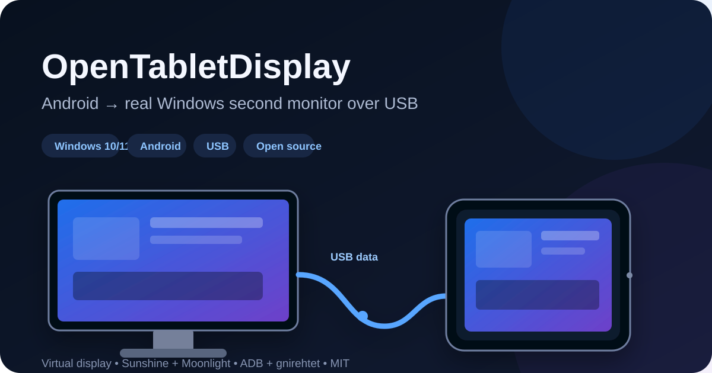

# OpenTabletDisplay

[](https://github.com/0pen-Sourcer/OpenTabletDisplay/actions/workflows/ci.yml) [](https://github.com/0pen-Sourcer/OpenTabletDisplay/releases/latest) [](LICENSE) [](docs/COMPATIBILITY.md)



**Turn an Android tablet or phone into a real extended Windows monitor over the USB cable you already have.**

OpenTabletDisplay gives Windows another display surface, captures that display with Sunshine, and carries the Sunshine/Moonlight session through a USB data path to Android. It is a **second monitor**, not a browser mirror.

> **Everyday use after setup:** plug in USB → open Moonlight → launch **Desktop**.

[**Download the latest Windows release**](https://github.com/0pen-Sourcer/OpenTabletDisplay/releases/latest) · [Compatibility](docs/COMPATIBILITY.md) · [Troubleshooting](docs/TROUBLESHOOTING.md) · [Report a device test](docs/DEVICE_TESTING.md)

## Why use it?

Most Android tablets cannot accept raw DisplayPort/HDMI video through USB-C. OpenTabletDisplay treats USB as a **data connection** instead:

- Windows sees a genuine virtual monitor that you can extend the desktop onto.
- Sunshine handles mature low-latency capture and hardware encoding.
- Moonlight handles mature Android hardware decode and input.
- ADB + gnirehtet carry the required TCP and UDP traffic through USB.
- OpenTabletDisplay owns the integration: install/reuse, device selection, health checks, reconnect, rollback and uninstall.

No custom Android client and no home-grown video codec are required.

## Architecture

```text
Windows applications
        │
        ▼
Virtual Display Driver
(real extended desktop surface)
        │
        ▼
Sunshine
(capture + hardware encode)
        │
        ▼
OpenTabletDisplay USB bridge
(ADB + gnirehtet, TCP + UDP)
        │
        ▼
ordinary USB data cable
        │
        ▼
Moonlight for Android
(hardware decode + input)
        │
        ▼
Android tablet / phone
```

The virtual display is selected using Sunshine's stable display-device GUID rather than guessing from unstable Windows `DISPLAYn` numbering.

## Highlights

- **Real extended desktop** — move ordinary Windows apps onto the Android display.
- **USB-first transport** — Android Wi-Fi may remain off for display traffic.
- **Hardware accelerated** — Sunshine can use supported GPU encoders; Moonlight uses Android hardware decode.
- **Background reconnect** — no bridge console needs to stay open during normal use.
- **Device enrollment** — a second debugging-enabled phone cannot silently hijack the session.
- **Client-driven display mode** — no hard-coded Lenovo resolution or device ID.
- **Live transport verification** — real Android-side Sunshine TCP checks plus UDP relay verification before READY.
- **Existing installs respected** — compatible Sunshine/VDD installations are reused instead of duplicated.
- **Conservative rollback/uninstall** — changes are tracked by ownership rather than wildcard-deleting drivers, processes or user configuration.
- **Open source** — the OpenTabletDisplay integration layer is MIT licensed.

## Support

| | Current support |
| --- | --- |
| **Windows host** | Windows 10/11 x86-64 |
| **Android client** | Android with USB debugging + official Moonlight Game Streaming app (`com.limelight`) |
| **Transport** | USB data cable via ADB + gnirehtet |
| **Display** | VirtualDrivers Virtual Display Driver |
| **Capture / encoding** | Sunshine |
| **Decode / input** | Moonlight Android |
| **Tablet Wi-Fi** | May remain off for display traffic |

The full wired path has been validated end-to-end on a **Lenovo Tab M10 HD**. The runtime itself contains no Lenovo-specific device ID or fixed tablet-resolution assumption, but Android ROM/USB/VPN behavior varies, so reports from other hardware are especially useful.

### Current stable limitation

The stream packets themselves travel through USB, but stable **v3.1.1** still uses the Windows host's active physical IPv4 address as the Sunshine/Moonlight address identity. The PC therefore needs an active physical IPv4/default route while the session is established.

A host-only identity path is being developed separately and will not be called stable until it passes real-device validation.

## Install

1. Download and extract the latest [Windows release ZIP](https://github.com/0pen-Sourcer/OpenTabletDisplay/releases/latest).
2. Run **`install.cmd`**.
3. Install official **Moonlight Game Streaming** on Android.
4. Enable **Developer options → USB debugging**.
5. Connect a data-capable USB cable and approve the PC's RSA debugging prompt.
6. Keep Android's normal **USB tethering OFF**; OpenTabletDisplay uses its own ADB/gnirehtet path.
7. Approve gnirehtet's one-time Android VPN/Connection request.
8. Pair Moonlight with the host address shown by OpenTabletDisplay, then launch **Desktop**.

The first Android device that completes the live TCP + UDP checks becomes the enrolled display until you run `reset-device.cmd`.

### Recommended Moonlight settings

- **Optimize game settings:** ON
- **Resolution:** Native / preferred tablet resolution
- **Frame rate:** 60 FPS to start
- **Use touchscreen as a trackpad:** OFF for direct-touch-style interaction
- **Play audio on PC:** ON if you want audio on both the PC and Android device

OpenTabletDisplay deliberately does not rewrite Moonlight preferences behind your back.

## Status, switching devices and uninstall

The current 3.x package retains some internal **FSDL** names for upgrade compatibility with the project's original name.

- `status.cmd` — Sunshine/VDD/agent/bridge health + recent agent log
- `reset-device.cmd` — forget the enrolled Android device before switching
- `uninstall.cmd` — remove OpenTabletDisplay/FSDL integration and restore Sunshine settings it changed
- `installer\uninstall.ps1 -RemoveDependencies` — also remove Sunshine/VDD **only when install-state proves this project originally installed them**

Existing Sunshine credentials and Moonlight pairing state are preserved when compatible installations are reused.

## Help test hardware

CI can validate code, packaging and rollback logic. It cannot attach your USB controller, Android ROM or GPU.

If you have a Windows PC and an old Android tablet/phone, a successful **or failed** hardware report is useful. Please include:

- Windows version and GPU;
- Android model/version;
- native panel resolution/refresh rate;
- whether initial setup, reconnect, sleep/wake and uninstall worked;
- `status.cmd` output with credentials/private data removed.

See [Device testing](docs/DEVICE_TESTING.md) for the reporting format.

Particularly useful right now: Samsung, Pixel, Xiaomi, OnePlus and other non-Lenovo devices, plus AMD/Intel Windows GPUs.

## Safety / provenance

Third-party dependencies are downloaded from pinned upstream release URLs and checked against exact SHA-256 digests. Hashes are **integrity checks, not publisher trust proofs**; upstream signing and source provenance matter too.

The VDD publisher certificate is added to Trusted Publishers only for the install transaction and removed immediately if OpenTabletDisplay added it. Existing user-owned Sunshine/VDD state wins over the installer.

Read [Security](SECURITY.md), [Architecture](docs/ARCHITECTURE.md) and [Third-party notices](THIRD_PARTY_NOTICES.md) for details.

## Documentation

- [Architecture](docs/ARCHITECTURE.md)
- [Compatibility](docs/COMPATIBILITY.md)
- [Moonlight client setup](docs/MOONLIGHT.md)
- [Troubleshooting](docs/TROUBLESHOOTING.md)
- [Device testing](docs/DEVICE_TESTING.md)
- [Roadmap](docs/ROADMAP.md)
- [Security](SECURITY.md)
- [Third-party notices](THIRD_PARTY_NOTICES.md)

## Build and test

Windows:

```powershell
./scripts/build-release.ps1
```

Linux/macOS with Go installed:

```bash
./scripts/build-release.sh
```

The release build compiles the Windows x64 bridge plus the native Android ARM64 transport probe, runs tests/vet/race/self-tests, and packages the Windows release with checksums. GitHub Actions also parses every PowerShell installer script on a Windows runner.

The project follows a strict hardware boundary: automation proves everything it realistically can, while claims about the actual USB/display path are made only after real-device validation.

## Name / compatibility note

**OpenTabletDisplay** is the public product name. **FSDL** was the original project name and remains visible in parts of the 3.x runtime (`FSDL.exe`, install-state paths, scheduled-task names and Go module path) so existing installations and upgrades do not break for a cosmetic rename.

A later major release can migrate those internals with an explicit compatibility/rollback plan.

## License

The OpenTabletDisplay integration layer is MIT licensed. It downloads and orchestrates separate third-party projects under their own licenses; it does not relicense them. See [THIRD_PARTY_NOTICES.md](THIRD_PARTY_NOTICES.md).
