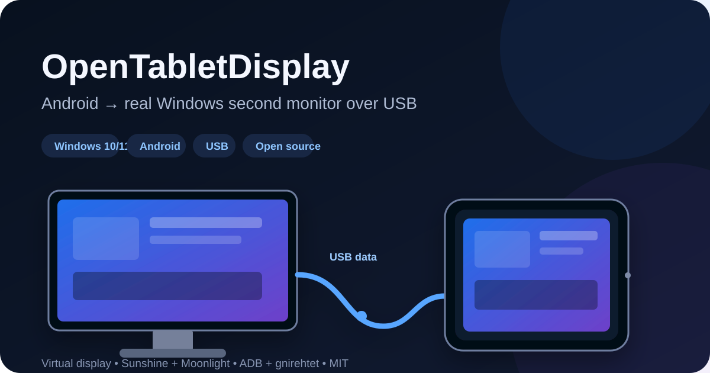

# OpenTabletDisplay

> **Development status (November 2026):** v3.1.1 remains the latest publicly released build and has known installer defects ([issue #11](https://github.com/0pen-Sourcer/OpenTabletDisplay/issues/11)). A new native Windows setup is under review in [PR #15](https://github.com/0pen-Sourcer/OpenTabletDisplay/pull/15). It is **not a stable release** until Windows/Android hardware QA, code signing, and security review pass. Do not bypass antivirus warnings to install an unsigned preview.


[](https://github.com/0pen-Sourcer/OpenTabletDisplay/actions/workflows/ci.yml) [](https://github.com/0pen-Sourcer/OpenTabletDisplay/releases/latest) [](LICENSE) [](docs/COMPATIBILITY.md)



**Turn an Android tablet or phone into a real extended Windows monitor over the USB cable you already have.**

OpenTabletDisplay gives Windows another display surface, captures that display with Sunshine, and carries the Sunshine/Moonlight session through a USB data path to Android. It is a **second monitor**, not a browser mirror.

> **Everyday use after setup:** plug in USB → open Moonlight → launch **Desktop**.

[**Download the latest Windows release**](https://github.com/0pen-Sourcer/OpenTabletDisplay/releases/latest) · [Compatibility](docs/COMPATIBILITY.md) · [Troubleshooting](docs/TROUBLESHOOTING.md) · [Report a device test](docs/DEVICE_TESTING.md)

## Why use it?

Most Android tablets cannot accept raw DisplayPort/HDMI video through USB-C. OpenTabletDisplay treats USB as a **data connection** instead:

- Windows sees a genuine virtual monitor that you can extend the desktop onto.
- Sunshine handles mature low-latency capture and hardware encoding.
- Moonlight handles mature Android hardware decode and input.
- ADB + gnirehtet carry the required TCP and UDP traffic through USB.
- OpenTabletDisplay owns the integration: install/reuse, device selection, health checks, reconnect, rollback and uninstall.

No custom Android client and no home-grown video codec are required.

## Architecture

```text
Windows applications
        │
        ▼
Virtual Display Driver
(real extended desktop surface)
        │
        ▼
Sunshine
(capture + hardware encode)
        │
        ▼
OpenTabletDisplay USB bridge
(ADB + gnirehtet, TCP + UDP)
        │
        ▼
ordinary USB data cable
        │
        ▼
Moonlight for Android
(hardware decode + input)
        │
        ▼
Android tablet / phone
```

The virtual display is selected using Sunshine's stable display-device GUID rather than guessing from unstable Windows `DISPLAYn` numbering.

## Highlights

- **Real extended desktop** — move ordinary Windows apps onto the Android display.
- **USB-first transport** — Android Wi-Fi may remain off for display traffic.
- **Hardware accelerated** — Sunshine can use supported GPU encoders; Moonlight uses Android hardware decode.
- **Background reconnect** — no bridge console needs to stay open during normal use.
- **Device enrollment** — a second debugging-enabled phone cannot silently hijack the session.
- **Client-driven display mode** — no hard-coded Lenovo resolution or device ID.
- **Live transport verification** — real Android-side Sunshine TCP checks plus UDP relay verification before READY.
- **Existing installs respected** — compatible Sunshine/VDD installations are reused instead of duplicated.
- **Conservative rollback/uninstall** — changes are tracked by ownership rather than wildcard-deleting drivers, processes or user configuration.
- **Open source** — the OpenTabletDisplay integration layer is MIT licensed.

## Support

| | Current support |
| --- | --- |
| **Windows host** | Windows 10/11 x86-64 |
| **Android client** | Android with USB debugging + official Moonlight Game Streaming app (`com.limelight`) |
| **Transport** | USB data cable via ADB + gnirehtet |
| **Display** | VirtualDrivers Virtual Display Driver |
| **Capture / encoding** | Sunshine |
| **Decode / input** | Moonlight Android |
| **Tablet Wi-Fi** | May remain off for display traffic |

The full wired path has been validated end-to-end on a **Lenovo Tab M10 HD**. The runtime itself contains no Lenovo-specific device ID or fixed tablet-resolution assumption, but Android ROM/USB/VPN behavior varies, so reports from other hardware are useful.

### Current stable limitation

The stream packets themselves travel through USB, but stable **v3.1.1** still uses the Windows host's active physical IPv4 address as the Sunshine/Moonlight address identity. The PC therefore needs an active physical IPv4/default route while the session is established.

## Install

> **Development preview:** The Windows desktop uses native WPF. The proposed 3.4 release candidate also moves installation and uninstall into the compiled executable; no PowerShell or batch installer files are bundled with that build. This is test code only, pending physical validation and trusted signing.

1. Download the complete packaged Windows ZIP, not GitHub's automatic Source code ZIP, and extract it.
2. Open **OpenTabletDisplay.exe**. The desktop UI is a compiled, self-contained .NET 10 WPF application—not a PowerShell-hosted window.
3. Choose **Install / repair**. Windows UAC appears only for installation and removal of system components. Do not bypass antivirus alerts or add exclusions.
4. Follow the one-time Android USB debugging authorization. Keep Android USB tethering OFF, and approve gnirehtet's explicit VPN prompt if shown.
5. Open **My devices**, scan for authorized Android devices, and explicitly enroll the intended device. Multiple devices are not selected automatically.
6. Install official Moonlight on Android, pair with Sunshine using the host address shown in the app, and launch Desktop.

The desktop app shows installer progress, dependency errors and local diagnostics. It blocks connection controls until Windows setup completes and preserves existing Sunshine settings where possible.

### Recommended Moonlight settings

- **Optimize game settings:** ON
- **Resolution:** Native / preferred tablet resolution
- **Frame rate:** 60 FPS to start
- **Use touchscreen as a trackpad:** OFF for direct-touch-style interaction
- **Play audio on PC:** ON if you want audio on both the PC and Android device

OpenTabletDisplay deliberately does not rewrite Moonlight preferences behind your back.

## Status, switching devices and uninstall

The current 3.x package retains some internal **FSDL** names for upgrade compatibility with the project's original name.

- **Diagnostics:** Sunshine, virtual-display driver, Android enrollment, USB bridge health and local logs.
- **My devices:** Select or forget an Android device.
- **Preferences & help → Choose components…:** Opens a checkbox dialog before uninstall. OpenTabletDisplay is selected by default; Sunshine and virtual display are unchecked. Additional removal is permitted only when the app's installation record and Windows component identity match. A final confirmation shows the exact choices.
- **Windows Installed apps:** The OpenTabletDisplay removal entry launches the same interface. External installations, unrelated device drivers and downloaded archives are not deleted automatically.

Existing Sunshine credentials and Moonlight pairing state are preserved when compatible installations are reused.

## Help test hardware

CI can validate code, packaging and rollback logic. It cannot attach your USB controller, Android ROM or GPU.

If you have a Windows PC and an old Android tablet/phone, a successful **or failed** hardware report is useful. Please include:

- Windows version and GPU;
- Android model/version;
- native panel resolution/refresh rate;
- whether initial setup, reconnect, sleep/wake and uninstall worked;
- a sanitized Diagnostics export from the Windows app.

See [Device testing](docs/DEVICE_TESTING.md) for the reporting format.

## Safety / provenance

Third-party dependencies are downloaded from pinned upstream release URLs and checked against exact SHA-256 digests. Hashes are **integrity checks, not publisher trust proofs**; upstream signing and source provenance matter too.

The VDD publisher certificate is added to Trusted Publishers only for the install transaction and removed immediately if OpenTabletDisplay added it. Existing user-owned Sunshine/VDD state wins over the installer.

Read [Security](SECURITY.md), [Architecture](docs/ARCHITECTURE.md) and [Third-party notices](THIRD_PARTY_NOTICES.md) for details.

## Documentation

- [Desktop app and first-run setup](docs/DESKTOP_APP.md)
- [Architecture](docs/ARCHITECTURE.md)
- [Compatibility](docs/COMPATIBILITY.md)
- [Moonlight client setup](docs/MOONLIGHT.md)
- [Troubleshooting](docs/TROUBLESHOOTING.md)
- [Device testing](docs/DEVICE_TESTING.md)
- [Roadmap](docs/ROADMAP.md)
- [Security](SECURITY.md)
- [Third-party notices](THIRD_PARTY_NOTICES.md)

## Build and test

Windows:

```powershell
./scripts/build-release.ps1
```

Linux/macOS with Go installed (cross-build tests only; not a Windows app release):

```bash
./scripts/build-release.sh
```

The Windows build generates the app icon, compiles the Go transport and Android probe, publishes the self-contained .NET 10 WPF desktop EXE, and verifies package SHA-256 checksums. The Linux/macOS script only tests and cross-compiles the transport; it cannot publish a Windows desktop ZIP. Windows CI launches the actual native WPF smoke test. Public release automation refuses unsigned executables or missing physical hardware QA signoff.

The project follows a strict hardware boundary: automation proves everything it realistically can, while claims about the actual USB/display path are made only after real-device validation.

## Name / compatibility note

**OpenTabletDisplay** is the public product name. **FSDL** was the original project name and remains visible in parts of the 3.x runtime (`FSDL.exe`, install-state paths, scheduled-task names and Go module path) so existing installations and upgrades do not break for a cosmetic rename.

## License

The OpenTabletDisplay integration layer is MIT licensed. It downloads and orchestrates separate third-party projects under their own licenses; it does not relicense them. See [THIRD_PARTY_NOTICES.md](THIRD_PARTY_NOTICES.md).
